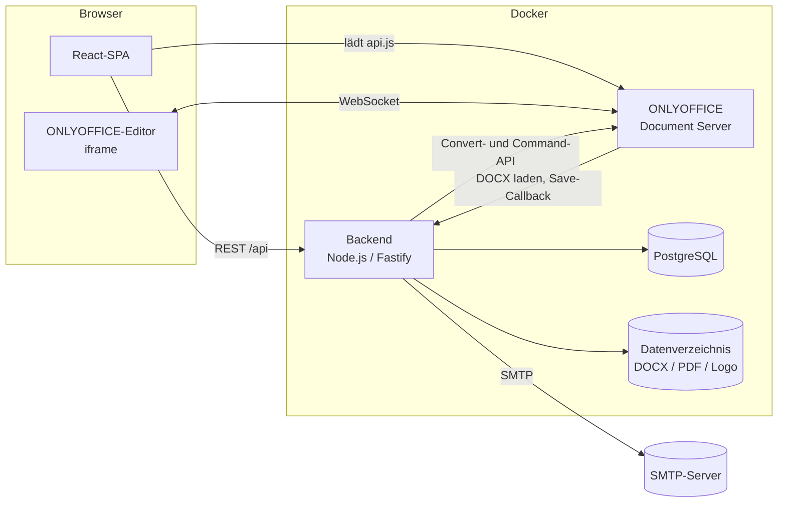
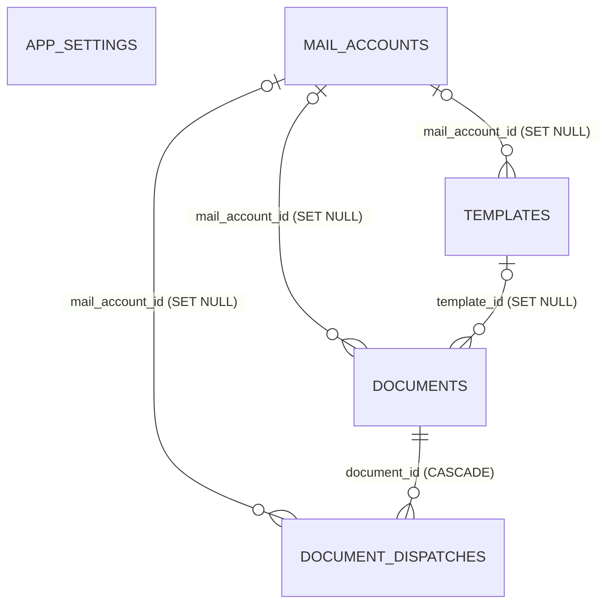
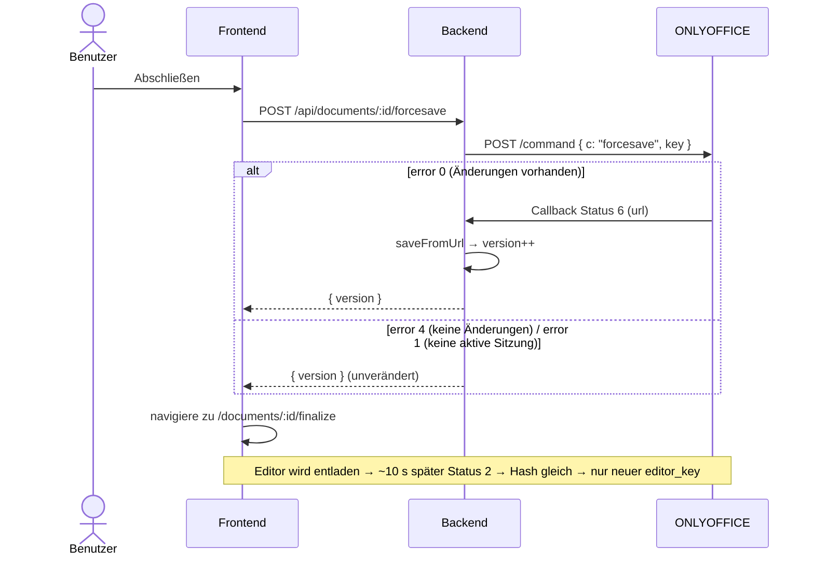

# Community Manager – Spezifikation

Verwaltungstool für Vereinsangelegenheiten. **Version 1:** Erstellung, Ablage, Einsicht und Mailversand von Sitzungsprotokollen.

| | |
|---|---|
| Stand | 07.10.2026 |
| Status | v0.2 – Grundlage für die Implementierung |
| Entscheidungen | im Text markiert mit **[A1]** … **[A10]**, gesammelt in [Kapitel 12](#12-entscheidungen) |

## Inhalt

1. [Überblick](#1-überblick)
2. [Begriffe](#2-begriffe)
3. [Architektur](#3-architektur)
4. [Datenmodell](#4-datenmodell)
5. [Abläufe (Backend-Logik)](#5-abläufe-backend-logik)
6. [REST-API](#6-rest-api)
7. [Frontend](#7-frontend)
8. [Fehlerbehandlung & Randfälle](#8-fehlerbehandlung--randfälle)
9. [Nicht-funktionale Anforderungen](#9-nicht-funktionale-anforderungen)
10. [Sicherheit (vor Einführung der Authentifizierung)](#10-sicherheit-vor-einführung-der-authentifizierung)
11. [Umsetzungsreihenfolge](#11-umsetzungsreihenfolge)
12. [Entscheidungen](#12-entscheidungen)
13. [Ausblick](#13-ausblick)

---

## 1. Überblick

### 1.1 Ziel

Ein schlankes, selbst gehostetes Web-Tool, mit dem ein Verein Dokumente (zunächst Sitzungsprotokolle) im Browser erstellt und bearbeitet (ONLYOFFICE), geordnet ablegt, durchsucht, als PDF abschließt und per Mail an festgelegte Empfänger versendet. Dabei bleibt nachvollziehbar, wer welchen Stand wann erhalten hat.

### 1.2 Umfang Version 1

- **Startseite** mit Menü
- **Einstellungen:** Community-Name, Logo, Hell-/Dunkelmodus (lokal im Browser), Mail-Konten (SMTP)
- **Vorlagen:** anlegen, benennen, taggen, Mailversand voreinstellen, löschen
- **Dokumente:** anlegen (leer oder aus Vorlage), bearbeiten (ONLYOFFICE), ansehen (nur lesen), löschen
- **Dokumentliste:** Volltextsuche, Tag-Filter (ODER), Nachladen beim Scrollen
- **Abschluss:** PDF-Erzeugung, Tags pflegen, Mailversand mit Versandhistorie und Versionsabgleich

### 1.3 Bewusst nicht in Version 1

- Authentifizierung, Benutzer, Rechte (Betrieb bis dahin nur in vertrauenswürdigem Netz, siehe Kap. 10)
- Vorlageninhalt (DOCX-Vorlage mit Platzhaltern). Neue Dokumente sind vorerst immer leer.
- Archiv alter Dokumentstände (nur der aktuelle Stand wird gespeichert, **[A2]**)
- Mehrsprachigkeit (die Oberfläche ist deutsch)

---

## 2. Begriffe

| Begriff | Bedeutung |
|---|---|
| **Dokument** | Eine DOCX-Datei plus Datensatz mit Metadaten (Titel, Tags, Mail-Konfiguration, Versandhistorie …). |
| **Vorlage** | Benannte Voreinstellung für neue Dokumente: Tags und Mailversand-Konfiguration, später auch Inhalt. |
| **Version** | Ganzzahliger Zähler je Dokument. Er steigt bei jeder gespeicherten inhaltlichen Änderung und ist der Bezug für PDF-Aktualität und Versand. |
| **PDF** | Aus der DOCX erzeugte PDF. Sie ist *aktuell*, wenn `pdf_version = version` gilt. |
| **Mail-Konto** | SMTP-Zugangsdaten, über die versendet wird. |
| **Versendung** (Dispatch) | Eine Mail eines bestimmten Stands (Version) von einem Absender an eine **Empfängerliste**: eine gemeinsame Mail, alle Empfänger im „An“-Feld **[A1]**. |
| **Versandgruppe** | Alle Versendungen eines Dokuments mit gleichem Absender und gleicher Empfängerliste. So werden sie auf der Abschlussseite angezeigt. |
| **Tag** | Freies Schlagwort an Dokumenten und Vorlagen. |
| **Abschluss** | Schritt nach dem Bearbeiten: PDF erzeugen, Tags prüfen, versenden. |

---

## 3. Architektur

### 3.1 Komponenten



- **Frontend:** Single-Page-App, spricht ausschließlich mit dem Backend (`/api`). Den Editor bindet sie über die ONLYOFFICE-React-Komponente ein.
- **Backend:** schlanker REST-Server. Er hält die Daten, verwaltet die Dateien, signiert die Editor-Konfigurationen, nimmt ONLYOFFICE-Callbacks entgegen, stößt PDF-Konvertierungen an und versendet Mails.
- **ONLYOFFICE Document Server:** bearbeitet und zeigt DOCX an und konvertiert DOCX → PDF.
- **PostgreSQL:** speichert alle Daten inklusive Volltextindex.
- **Datenverzeichnis:** Docker-Volume für DOCX, PDF und Logo.

### 3.2 Tech-Stack

| Bereich | Wahl | Zweck |
|---|---|---|
| Sprache | TypeScript (strict) in allen Teilen | Typen zwischen Frontend und Backend teilen |
| Monorepo | npm Workspaces | `apps/backend`, `apps/frontend`, `packages/shared` |
| Backend | Node.js 22 LTS, **Fastify 5** | schlank, schnell, Schema-Validierung |
| Validierung | **zod** + eigener `parse()`-Helfer | dieselben Schemas im Backend und Frontend (`packages/shared`); kein Type-Provider, da dieser Swagger/OpenAPI als Pflichtabhängigkeit mitzieht |
| DB-Zugriff | **Kysely** + `pg` | typsicheres SQL ohne ORM-Ballast, eingebaute Migrationen |
| Mail | **nodemailer** | SMTP-Versand |
| DOCX → HTML/Text | **mammoth** | Mail-Body (HTML) und Volltext (Rohtext) |
| DOCX → PDF | ONLYOFFICE Conversion API | originalgetreues PDF |
| JWT (ONLYOFFICE) | **jose** | Editor-Config signieren, Callbacks prüfen |
| Uploads | `@fastify/multipart` | Logo |
| Statische Auslieferung | `@fastify/static` | Frontend-Build in Produktion |
| Frontend | **React 19**, **Vite** | |
| Routing | React Router 8 | |
| Server-State | **TanStack Query 5** | Caching, Infinite Query, Polling |
| Editor | `@onlyoffice/document-editor-react` | |
| Styling | CSS Modules + CSS Custom Properties (Design-Tokens) | kein UI-Framework, Theming über Variablen |
| Icons | `lucide-react` | |
| Tests | Vitest | Kernlogik (Versandgruppen, Suchausdruck, Versionierung) |

### 3.3 Repository-Struktur

```
community-manager/
├─ docker-compose.yml
├─ .env.example
├─ package.json                 # Workspaces + Root-Skripte (dev, build, lint, test)
├─ docs/
│  └─ SPEZIFIKATION.md
├─ packages/
│  └─ shared/                   # DTO-Typen, zod-Schemas, reine Logik (z. B. buildDispatchGroups)
│     └─ src/
├─ apps/
│  ├─ backend/
│  │  ├─ assets/blank.docx      # leere, gültige DOCX (A4) als Basis neuer Dokumente
│  │  └─ src/
│  │     ├─ index.ts            # Start, Graceful Shutdown
│  │     ├─ app.ts              # Fastify-Instanz, Plugins, Routen
│  │     ├─ config.ts           # Env lesen und validieren (zod)
│  │     ├─ db/
│  │     │  ├─ db.ts            # Kysely-Instanz
│  │     │  ├─ types.ts         # DB-Typen
│  │     │  └─ migrations/
│  │     ├─ modules/
│  │     │  ├─ settings/        # routes.ts, service.ts
│  │     │  ├─ mail-accounts/
│  │     │  ├─ templates/
│  │     │  ├─ documents/       # inkl. storage.ts, search.ts, pdf.ts
│  │     │  ├─ dispatches/
│  │     │  ├─ tags/
│  │     │  └─ onlyoffice/      # routes (file, callback), client (convert, command), jwt
│  │     └─ lib/                # crypto.ts, mailer.ts, docx.ts, mutex.ts, files.ts, errors.ts
│  └─ frontend/
│     └─ src/
│        ├─ main.tsx, App.tsx   # Router, QueryClient, Theme-Provider
│        ├─ api/                # fetch-Client + Query-/Mutation-Hooks je Ressource
│        ├─ components/         # wiederverwendbare UI-Bausteine (Kap. 7.5)
│        ├─ features/           # documents/, templates/, settings/, mail/
│        ├─ pages/              # eine Datei je Route, möglichst dünn
│        ├─ hooks/              # useTheme, useDebouncedValue, useAutosave …
│        ├─ lib/                # format.ts (Datum), email.ts …
│        └─ styles/             # tokens.css, global.css
```

### 3.4 Betrieb mit Docker

`docker-compose.yml` mit drei Diensten (+ Volumes):

| Dienst | Image | Hinweise |
|---|---|---|
| `db` | `postgres:17` | Volume `pgdata`, Host-Port `DB_PORT` (Standard 5433) nur für die Entwicklung |
| `onlyoffice` | `onlyoffice/documentserver:9.4.0.1` (gepinnt) | `JWT_ENABLED=true`, `JWT_SECRET`, **`ALLOW_PRIVATE_IP_ADDRESS=true`** (sonst kann der DS das Backend im Docker-Netz bzw. auf dem Host nicht erreichen), `extra_hosts: host.docker.internal:host-gateway`, Host-Port `ONLYOFFICE_PORT` (Standard 8090) → 80 |
| `app` | eigenes Image (Multi-Stage-Build) | Backend liefert in Produktion auch den Frontend-Build aus. Volume `data:/data` |

**Entwicklung:** `db` und `onlyoffice` laufen in Docker. Backend (`tsx watch`) und Frontend (Vite-Dev-Server mit Proxy `/api` → Backend) laufen lokal. Der Document Server erreicht das lokale Backend über `http://host.docker.internal:3000`.

**Produktion:** alle drei Dienste in Docker. Der DS erreicht das Backend über `http://app:3000`. Für den Browser braucht es einen Reverse-Proxy (TLS) vor `app` und `onlyoffice`. Das ist nicht Teil von v1, ein Hinweis in der README genügt.

### 3.5 Konfiguration (`.env`)

| Variable | Beispiel (Dev) | Bedeutung |
|---|---|---|
| `PORT` | `3000` | Port des Backends |
| `DATABASE_URL` | `postgres://cm:cm@localhost:5433/cm` | |
| `DATA_DIR` | `./data` | Wurzel für `documents/`, `branding/` |
| `APP_SECRET` | 32 Byte, base64 | Schlüssel zur Verschlüsselung der SMTP-Passwörter |
| `ONLYOFFICE_PUBLIC_URL` | `http://localhost:8090` | Browser → DS (lädt `api.js`) |
| `ONLYOFFICE_INTERNAL_URL` | `http://localhost:8090` | Backend → DS (Convert/Command) |
| `ONLYOFFICE_JWT_SECRET` | zufällig | identisch mit `JWT_SECRET` des DS |
| `BACKEND_URL_FOR_ONLYOFFICE` | `http://host.docker.internal:3000` | DS → Backend (Datei-Download, Callback) |

`config.ts` validiert alle Variablen beim Start mit zod. Fehlt eine Variable oder ist sie ungültig, beendet sich der Prozess mit einer klaren Fehlermeldung.

### 3.6 URL-Topologie (häufigste Stolperfalle)

Mit ONLYOFFICE gibt es **drei Blickrichtungen**, jede mit eigener Basis-URL:

1. **Browser → DS:** `ONLYOFFICE_PUBLIC_URL` (Skript `web-apps/apps/api/documents/api.js`)
2. **DS → Backend:** `BACKEND_URL_FOR_ONLYOFFICE` (`document.url`, `callbackUrl`, Quell-URL bei Konvertierungen)
3. **Backend → DS:** `ONLYOFFICE_INTERNAL_URL` (`/converter`, `/command`)

`localhost` aus Sicht des DS-Containers ist der Container selbst, nicht der Host.

---

## 4. Datenmodell

### 4.1 Übersicht



### 4.2 Tabellen

```sql
-- Migration 001_init  (gen_random_uuid() ist ab PostgreSQL 13 eingebaut)

CREATE TABLE app_settings (
  id              smallint    PRIMARY KEY DEFAULT 1 CHECK (id = 1),   -- genau eine Zeile
  community_name  text        NOT NULL DEFAULT 'Mein Verein',
  logo_filename   text,                                               -- relativ zu DATA_DIR/branding
  logo_mime       text,
  updated_at      timestamptz NOT NULL DEFAULT now()
);
INSERT INTO app_settings DEFAULT VALUES;

CREATE TABLE mail_accounts (
  id              uuid        PRIMARY KEY DEFAULT gen_random_uuid(),
  label           text,                     -- optional, Anzeige im Dropdown (Fallback: smtp_user)   [A7]
  smtp_host       text        NOT NULL,
  smtp_port       integer     NOT NULL CHECK (smtp_port BETWEEN 1 AND 65535),
  smtp_user       text        NOT NULL,
  smtp_pass_enc   text        NOT NULL,     -- AES-256-GCM mit APP_SECRET, nie an das Frontend
  from_address    text,                     -- optional (Fallback: smtp_user)                        [A7]
  from_name       text,                     -- optional (Fallback: community_name)                   [A7]
  created_at      timestamptz NOT NULL DEFAULT now(),
  updated_at      timestamptz NOT NULL DEFAULT now()
);

CREATE TABLE templates (
  id                    uuid        PRIMARY KEY DEFAULT gen_random_uuid(),
  name                  text        NOT NULL,
  tags                  text[]      NOT NULL DEFAULT '{}',
  mail_enabled          boolean     NOT NULL DEFAULT false,
  mail_account_id       uuid        REFERENCES mail_accounts(id) ON DELETE SET NULL,
  mail_account_deleted  boolean     NOT NULL DEFAULT false,   -- true, wenn das gewählte Konto gelöscht wurde
  mail_recipients       text[]      NOT NULL DEFAULT '{}',
  created_at            timestamptz NOT NULL DEFAULT now(),
  updated_at            timestamptz NOT NULL DEFAULT now()
);

CREATE TABLE documents (
  id                    uuid        PRIMARY KEY DEFAULT gen_random_uuid(),
  title                 text        NOT NULL,
  storage_path          text        NOT NULL,   -- relativ zu DATA_DIR/documents, z. B. '2026/10'
  docx_filename         text        NOT NULL,
  pdf_filename          text,                   -- gesetzt nach erster PDF-Erzeugung
  template_id           uuid        REFERENCES templates(id) ON DELETE SET NULL,
  template_name         text,                   -- Snapshot des Vorlagennamens; NULL = leeres Dokument
  version               integer     NOT NULL DEFAULT 1,
  content_hash          text        NOT NULL,   -- Inhalts-Hash der DOCX (siehe 5.2)
  editor_key            text        NOT NULL,   -- ONLYOFFICE document.key (siehe 5.2)
  content_text          text        NOT NULL DEFAULT '',
  search_vector         tsvector    GENERATED ALWAYS AS (
                          setweight(to_tsvector('german', title), 'A') ||
                          setweight(to_tsvector('german', content_text), 'B')
                        ) STORED,
  tags                  text[]      NOT NULL DEFAULT '{}',
  mail_enabled          boolean     NOT NULL DEFAULT false,
  mail_account_id       uuid        REFERENCES mail_accounts(id) ON DELETE SET NULL,
  mail_account_deleted  boolean     NOT NULL DEFAULT false,
  mail_recipients       text[]      NOT NULL DEFAULT '{}',
  pdf_version           integer,                -- Version, aus der die PDF erzeugt wurde
  pdf_created_at        timestamptz,
  created_at            timestamptz NOT NULL DEFAULT now(),   -- Erstelldatum
  edited_at             timestamptz NOT NULL DEFAULT now(),   -- Bearbeitungsdatum (letzte Inhaltsänderung)
  updated_at            timestamptz NOT NULL DEFAULT now()    -- letzte Änderung am Datensatz (Titel, Tags …)
);
CREATE INDEX documents_list_idx   ON documents (created_at DESC, id DESC);
CREATE INDEX documents_search_idx ON documents USING gin (search_vector);
CREATE INDEX documents_tags_idx   ON documents USING gin (tags);

CREATE TABLE document_dispatches (
  id                uuid        PRIMARY KEY DEFAULT gen_random_uuid(),
  document_id       uuid        NOT NULL REFERENCES documents(id) ON DELETE CASCADE,
  document_version  integer     NOT NULL,     -- welcher Stand versendet wurde
  mail_account_id   uuid        REFERENCES mail_accounts(id) ON DELETE SET NULL,
  from_address      text        NOT NULL,     -- Snapshot, bleibt nach Löschen des Kontos erhalten
  to_addresses      text[]      NOT NULL,     -- Empfängerliste (gemeinsame Mail), normalisiert + sortiert [A1]
  rejected_addresses text[]     NOT NULL DEFAULT '{}',   -- vom SMTP-Server abgelehnte Adressen
  subject           text        NOT NULL,
  intro_text        text,                     -- optionaler Begleittext
  status            text        NOT NULL CHECK (status IN ('pending', 'sent', 'failed')),
  error             text,
  message_id        text,                     -- SMTP Message-ID
  created_at        timestamptz NOT NULL DEFAULT now(),
  sent_at           timestamptz
);
CREATE INDEX document_dispatches_doc_idx ON document_dispatches (document_id, created_at DESC);
```

**Abgeleitete Werte**, die die API berechnet und nicht speichert:

| Wert | Regel |
|---|---|
| Vorlage gelöscht | `template_id IS NULL AND template_name IS NOT NULL` |
| Leeres Dokument | `template_name IS NULL` |
| PDF aktuell | `pdf_version = version` und die Datei existiert |
| Absenderadresse eines Kontos | `from_address ?? smtp_user` |
| Anzeigename eines Kontos | `label ?? smtp_user` |

### 4.3 Tags

- Gespeichert als `text[]` direkt an `templates` und `documents`. Eine eigene Tag-Tabelle ist nicht nötig.
- **Normalisierung** (Backend und Frontend): trimmen, Mehrfach-Leerzeichen zusammenfassen, maximal 50 Zeichen, leere Werte verwerfen, Duplikate ohne Rücksicht auf Groß-/Kleinschreibung entfernen.
- **Schreibweise:** Existiert ein Tag bereits in anderer Groß-/Kleinschreibung, übernimmt die Eingabe die vorhandene Schreibweise (das erledigt das Frontend über die Vorschläge).
- **Vorschläge** (Eingabe): alle Tags aus Dokumenten **und** Vorlagen.
  ```sql
  SELECT DISTINCT tag FROM (
    SELECT unnest(tags) AS tag FROM documents
    UNION ALL
    SELECT unnest(tags) FROM templates
  ) t ORDER BY lower(tag);
  ```
- **Filterleiste** (Dokumentliste): nur Tags, die an Dokumenten vorkommen.
- Nicht mehr verwendete Tags verschwinden automatisch, weil sie nur abgeleitet werden.
- **Empfängeradressen** (`mail_recipients`) funktionieren genauso: `text[]`, kleingeschrieben, validiert. Vorschläge kommen aus allen bisher verwendeten Adressen (Vorlagen, Dokumente, Versendungen). In der Konfiguration bleibt die eingegebene Reihenfolge erhalten. In Versendungen (`to_addresses`) wird die Liste sortiert gespeichert, damit gleiche Listen unabhängig von der Reihenfolge als gleich erkannt werden.

### 4.4 Dateiablage

```
DATA_DIR/
├─ branding/
│  └─ logo.<png|jpg|webp|svg>
└─ documents/
   └─ <YYYY>/<MM>/                                   # Jahr/Monat des Erstelldatums
      ├─ 2026-10-07_vorstandssitzung-07-10-2026_a1b2c3d4.docx
      └─ 2026-10-07_vorstandssitzung-07-10-2026_a1b2c3d4.pdf
```

- Dateiname: `<Erstelldatum>_<Slug des Titels>_<erste 8 Zeichen der ID>`. Er wird **einmalig beim Anlegen** festgelegt und bei Titeländerungen nicht umbenannt.
- Die PDF hat denselben Basisnamen. Bei Neuerzeugung wird sie überschrieben.
- Schreibzugriffe sind atomar: erst in eine Temp-Datei im selben Ordner schreiben, dann `rename`.
- In der DB stehen nur relative Pfade (`storage_path`, `docx_filename`, `pdf_filename`). Dadurch lässt sich `DATA_DIR` verschieben.

### 4.5 Löschverhalten

| Gelöscht wird … | Auswirkung |
|---|---|
| **Mail-Konto** | In **einer** Transaktion: alle Vorlagen und Dokumente mit diesem Konto bekommen `mail_account_id = NULL, mail_account_deleted = true`, danach wird das Konto gelöscht. Versendungen behalten `from_address` (Snapshot), `mail_account_id` wird `NULL`. Wählt man später ein neues Konto, wird `mail_account_deleted` wieder `false`. |
| **Vorlage** | `documents.template_id` wird per FK `NULL`. `template_name` bleibt erhalten, im Dokument erscheint „Vorlage gelöscht“. |
| **Dokument** | Datensatz löschen (Versendungen per CASCADE), danach DOCX und PDF von der Platte entfernen. Fehlende Dateien (`ENOENT`) werden ignoriert. |

---

## 5. Abläufe (Backend-Logik)

### 5.1 Dokument anlegen

`POST /api/documents { templateId: string | null }`

1. Vorlage laden, falls angegeben (404, wenn nicht vorhanden).
2. Titel erzeugen **[A3]**: `"<Vorlagenname> <TT.MM.JJJJ>"`, ohne Vorlage `"Dokument <TT.MM.JJJJ>"`.
3. Pfad und Dateinamen bestimmen (4.4), Ordner anlegen (`mkdir -p`).
4. `assets/blank.docx` dorthin kopieren. Später wird hier aus dem Vorlageninhalt generiert.
5. Datensatz anlegen:
   - `version = 1`, `content_hash = Inhalts-Hash`, `editor_key = neuer Key`, `content_text = ''`
   - aus der Vorlage **kopieren [A5]:** `tags`, `mail_enabled`, `mail_account_id`, `mail_account_deleted`, `mail_recipients`, `template_name`
6. Antwort: das Dokument. Das Frontend navigiert zu `/documents/:id/edit`.

Hinweis: Der Datensatz entsteht sofort. Wer den Editor ohne Änderungen verlässt, behält ein leeres Dokument, das sich normal löschen lässt.

### 5.2 Bearbeiten & Speichern (ONLYOFFICE)

**Editor-Konfiguration:** `GET /api/documents/:id/editor-config?mode=edit|view&theme=light|dark`

```jsonc
{
  "documentServerUrl": "<ONLYOFFICE_PUBLIC_URL>",
  "config": {
    "documentType": "word",
    "document": {
      "fileType": "docx",
      "key": "<editor_key>",
      "title": "<Titel>.docx",
      "url": "<BACKEND_URL_FOR_ONLYOFFICE>/api/onlyoffice/documents/<id>/file",
      "permissions": { "edit": true /* false bei view */, "download": true, "print": true }
    },
    "editorConfig": {
      "mode": "edit",                       // bzw. "view"
      "lang": "de",
      "region": "de-DE",
      "callbackUrl": "<BACKEND_URL_FOR_ONLYOFFICE>/api/onlyoffice/documents/<id>/callback",
      "user": { "id": "local", "name": "Vorstand" },   // Platzhalter bis zur Authentifizierung
      "customization": {
        "autosave": true,
        "forcesave": false,
        "compactHeader": true,
        "uiTheme": "default-dark"           // bzw. "default-light", passend zum App-Theme
      }
    },
    "token": "<JWT (HS256) über das gesamte config-Objekt>"
  }
}
```

**Key-Regeln** (`editor_key`): erlaubt sind `[0-9A-Za-z._=-]`, höchstens 128 Zeichen. Format: `<id ohne Bindestriche>-<8 Zufallszeichen>`. Ein Key gilt für eine Bearbeitungssitzung. Nach dem endgültigen Speichern (Status 2) **muss** ein neuer Key vergeben werden.

**Datei für den DS:** `GET /api/onlyoffice/documents/:id/file` liefert die aktuelle DOCX. Bei aktiviertem JWT sendet der DS einen `Authorization: Bearer <jwt>`-Header, den das Backend prüft.

**Callback:** `POST /api/onlyoffice/documents/:id/callback`. Das Backend prüft das JWT (`body.token` oder `Authorization`-Header) und antwortet mit `{"error": 0}`. Schlägt die Verarbeitung fehl (z. B. Download), antwortet es mit `{"error": 1}`: Der DS behält die Änderungen dann und wiederholt den Callback. Ungültige oder fehlende Tokens ergeben 401/403.

| Status | Bedeutung | Reaktion |
|---|---|---|
| 1 | wird bearbeitet | nichts |
| 2 | Sitzung beendet, Dokument zum Speichern bereit (~10 s nach Schließen des letzten Editors) | `saveFromUrl(url)` (s. u.), danach **immer** neuen `editor_key` setzen |
| 3 | Fehler beim Speichern | loggen |
| 4 | geschlossen ohne Änderungen | nichts, Key bleibt |
| 6 | Force-Save (Sitzung läuft weiter) | `saveFromUrl(url)`, Key **bleibt**. Wartenden Force-Save-Aufruf auflösen (5.3). |
| 7 | Fehler beim Force-Save | loggen, wartenden Force-Save-Aufruf mit Fehler auflösen |

`saveFromUrl(url)`, pro Dokument über einen **In-Process-Mutex** serialisiert (derselbe Mutex wie bei der PDF-Erzeugung):

1. Datei von `url` herunterladen (Host durch `ONLYOFFICE_INTERNAL_URL` ersetzt) und den **Inhalts-Hash** berechnen: SHA-256 über die entpackten ZIP-Einträge, sortiert nach Namen, ohne `docProps/*`. Ein Hash über die Datei selbst taugt nicht: ONLYOFFICE erzeugt bei jedem Speichern einen neuen ZIP-Container (Zeitstempel, Kompression), auch ohne inhaltliche Änderung. Das hätte nach jedem Sitzungsende eine neue Version ausgelöst und PDF sowie Versand als veraltet markiert.
2. Hash gleich `content_hash` → keine neue Version. Ein Callback mit einem anderen als dem aktuellen `editor_key` wird ignoriert.
3. Sonst: Datei atomar ersetzen, `version += 1`, `content_hash` setzen, `edited_at = now()`, `content_text = mammoth.extractRawText()`. Der Suchindex aktualisiert sich über die generierte Spalte.

Damit entspricht eine Version ungefähr einer Bearbeitungssitzung bzw. einem „Abschließen“.

### 5.3 Abschließen (Force-Save)

Problem: Ohne Force-Save speichert der DS erst ~10 s nach dem Schließen des Editors. Die Abschlussseite würde sonst einen veralteten Stand zeigen und versenden.

Ablauf bei Klick auf **„Abschließen“** (der Editor ist noch geöffnet):



- Das Backend wartet nach `error 0` bis zu **20 s** auf den Callback mit Status 6 (Map `docId → Promise` im Speicher).
- Timeout → `504`. Das Frontend zeigt „Speichern dauert ungewöhnlich lange – bitte erneut versuchen“, der Button bleibt aktiv.
- Endpunkt: `/command` (ältere DS-Versionen: `/coauthoring/CommandService.ashx`), Body mit `token` (JWT).

### 5.4 PDF-Erzeugung

`POST /api/documents/:id/pdf`: synchron, idempotent, pro Dokument per Mutex serialisiert. Gleichzeitige Aufrufe warten auf dieselbe laufende Erzeugung.

1. Ist die PDF aktuell (`pdf_version = version`, Datei vorhanden)? → sofort zurückgeben.
2. `POST <ONLYOFFICE_INTERNAL_URL>/converter` (ältere DS-Versionen: `/ConvertService.ashx`), `Accept: application/json`:
   ```json
   { "async": false, "filetype": "docx", "outputtype": "pdf",
     "key": "<id ohne Bindestriche>_v<version>_pdf", "title": "<Titel>.docx",
     "url": "<BACKEND_URL_FOR_ONLYOFFICE>/api/onlyoffice/documents/<id>/file",
     "token": "<JWT über den Body>" }
   ```
   Der Konvertierungs-Key hängt an der Version, damit greift der Cache des DS korrekt.
3. `fileUrl` aus der Antwort laden und atomar als `<basename>.pdf` speichern.
4. `pdf_filename`, `pdf_version = <Version aus Schritt 1>`, `pdf_created_at = now()` setzen.
5. Antwort: PDF-Info. Bei DS-Fehlern `502` mit Fehlercode des DS.

`GET /api/documents/:id/pdf` liefert die Datei mit `Content-Disposition: inline; filename="<Titel>.pdf"` aus, damit sie im neuen Tab angezeigt wird.

### 5.5 Dokumentliste & Volltextsuche

`GET /api/documents?q=&tags=&cursor=&limit=20`

- **Sortierung [A4]:** `created_at DESC, id DESC`, auch bei aktiver Suche (kein Relevanz-Ranking).
- **Paginierung:** Keyset statt Offset. `cursor` = base64(`<created_at ISO>|<id>`). Es werden `limit + 1` Zeilen gelesen, um `nextCursor` zu bestimmen.
- **Tags:** ODER-Verknüpfung über `tags && $tags::text[]`. Zusammen mit der Suche gilt: Suche **UND** (Tag1 **ODER** Tag2 …).
- **Suchausdruck** (Präfixsuche, damit schon Wortanfänge treffen): Eingabe in Wörter zerlegen, nur Buchstaben und Ziffern behalten (`\p{L}\p{N}`), jedes Wort als `<wort>:*`, verbunden mit `&`.
  Beispiel: `"Vorstand Kasse"` → `vorstand:* & kasse:*` → `to_tsquery('german', …)`. Die Funktion wird mit Vitest getestet.

```sql
SELECT id, title, created_at, edited_at, tags, template_id, template_name
FROM documents
WHERE ($1::text   IS NULL OR search_vector @@ to_tsquery('german', $1))
  AND ($2::text[] IS NULL OR tags && $2)
  AND ($3::timestamptz IS NULL OR (created_at, id) < ($3, $4::uuid))
ORDER BY created_at DESC, id DESC
LIMIT 21;
```

### 5.6 Mailversand

#### Mail-Konfiguration des Dokuments

- `mail_enabled`, `mail_account_id`, `mail_account_deleted`, `mail_recipients` werden beim Anlegen von der Vorlage kopiert **[A5]**.
- Auf der Abschlussseite lassen sie sich ändern. Änderungen gelten nur für dieses Dokument (`PATCH /api/documents/:id`).
- Hat das Dokument keinen Mailversand, zeigt die Abschlussseite „Mailversand hinzufügen“ **[A6]**.

#### Versandgruppen und Zustände

Eine Versendung ist **eine gemeinsame Mail an die ganze Empfängerliste** **[A1]**. Der Gruppenschlüssel ist daher `(from_address, Empfängermenge)`. Die Reihenfolge der Empfänger spielt keine Rolle: Die Liste wird normalisiert (kleingeschrieben, ohne Duplikate, sortiert). Die Gruppierung ist eine **reine Funktion** in `packages/shared` (`buildDispatchGroups`), die das Frontend verwendet und die mit Vitest getestet wird.

Eingaben: aktuelle `version`, aktuelle Konfiguration (Absenderadresse des gewählten Kontos und Empfängerliste), alle Versendungen des Dokuments.

1. Versendungen nach `(from, Empfängermenge)` gruppieren, innerhalb der Gruppe neueste zuerst.
2. Die Gruppe, die zur aktuellen Konfiguration passt, ist die **aktive Gruppe**. Gibt es sie noch nicht, wird sie leer ergänzt. Das setzt ein gültiges Konto und mindestens einen Empfänger voraus, sonst gibt es keine aktive Gruppe.
3. Nur die aktive Gruppe hat eine Aktion. Alle anderen Gruppen sind reine Historie, z. B. nach einem Wechsel von Konto oder Empfängern. Wer erneut an eine frühere Liste senden will, stellt die Konfiguration wieder darauf ein. Dann ist diese Gruppe wieder aktiv.
4. Zustand je Gruppe (erste zutreffende Regel gewinnt):

| Zustand | Regel | Anzeige | Aktion der aktiven Gruppe |
|---|---|---|---|
| `pending` | eine Versendung hat `pending` | „Wird versendet …“ (Spinner) | – |
| `current` | eine Versendung mit `document_version = version` hat `sent` | „Versendet“ ✓ | **„Nochmals senden“** (sekundär) **[A10]** |
| `failed` | neueste Versendung hat `failed` | „Fehlgeschlagen“ + Fehlermeldung | **„Erneut versuchen“** |
| `outdated` | es gibt `sent`, aber keine mit aktueller Version | „Neue Version (vX) – zuletzt vY versendet“ (Warnfarbe) | **„Erneut versenden“** |
| `new` | keine Versendungen | „Noch nicht versendet“ | **„Dokument versenden“** (primär) |

5. Reihenfolge: aktive Gruppe zuerst, danach die übrigen nach letzter Versendung absteigend (Überschrift „Frühere Empfängerlisten“).

Die Aktion ist deaktiviert, solange die PDF nicht aktuell bzw. noch in Erzeugung ist oder eine Änderung an der Mail-Konfiguration noch gespeichert wird. Jede Aktion öffnet zuerst den **Bestätigungsdialog** (7.4.9) mit optionalem Begleittext.

#### Versand im Backend

`POST /api/documents/:id/dispatches { accountId: string, recipients: string[], introText?: string }`

1. Prüfen:
   - Mailversand aktiv, Konto vorhanden (sonst `409 MAIL_ACCOUNT_MISSING`), Empfängerliste gültig und nicht leer.
   - `accountId` und `recipients` (als Menge verglichen) müssen der gespeicherten Konfiguration des Dokuments entsprechen, sonst `409 CONFIG_CHANGED`. So geht genau das raus, was im Dialog bestätigt wurde.
2. `ensurePdf()` (5.4).
3. **Snapshot** des Inhalts erzeugen, passend zur Version aus Schritt 2:
   - `version`, PDF-Buffer, Titel (Subject)
   - HTML-Body: `mammoth.convertToHtml()` der DOCX. Bilder werden über die `convertImage`-Option zu CID-Anhängen (`cid:img-n`) statt Data-URIs, die viele Mailclients blockieren.
   - Text-Alternative: Begleittext + `content_text`
4. Eine Zeile mit `status = 'pending'` und `to_addresses` (normalisiert, sortiert) anlegen und mit `202` zurückgeben.
5. **Im Hintergrund** (im selben Prozess) die Mail senden:
   - Erfolg: Zeile auf `sent` setzen, mit `sent_at`, `message_id` und `rejected_addresses` aus `info.rejected`. Lehnt der Server einzelne Adressen ab, bleibt die Versendung `sent`, die abgelehnten Adressen erscheinen als Warnung am Eintrag.
   - Fehler: Zeile auf `failed` setzen, mit `error`.
6. Beim Serverstart werden `pending`-Zeilen, die älter als 5 Minuten sind, auf `failed` gesetzt („Versand durch Neustart abgebrochen“).

**Aufbau der Mail:**

| Teil | Inhalt |
|---|---|
| From | `"<from_name ?? community_name>" <from_address ?? smtp_user>` |
| To | alle Empfänger der Liste in einem gemeinsamen „An“-Feld **[A1]** |
| Subject | Dokumenttitel |
| HTML | optionaler Begleittext (HTML-escaped, Zeilenumbrüche → `<br>`, in `<p>`), darunter `<hr>`, darunter der Dokumentinhalt als HTML. Schlichter Wrapper mit Inline-Styles (Schrift, max. Breite). |
| Text | Begleittext + Leerzeile + `content_text` |
| Anhang | `<Titel>.pdf` (aktuelle Version) |

**SMTP:** `nodemailer.createTransport({ host, port, secure: port === 465, auth: { user, pass } })`. Bei anderen Ports wird STARTTLS genutzt, wenn der Server es anbietet **[A7]**. Timeouts: 15 s Verbindungsaufbau, 60 s Senden.

### 5.7 Löschen

| Was | Endpunkt | Bestätigungsdialog im Frontend |
|---|---|---|
| Mail-Konto | `DELETE /api/mail-accounts/:id` | „Mail-Konto „X“ löschen?“ + bei Verwendung: **„Wird von N Vorlagen verwendet. Dort muss anschließend ein neues Konto gewählt werden.“** |
| Vorlage | `DELETE /api/templates/:id` | „Vorlage „X“ löschen? Bereits erstellte Dokumente bleiben erhalten.“ (keine Anzahl) |
| Dokument | `DELETE /api/documents/:id` | „Dokument „X“ endgültig löschen? DOCX, PDF und Versandhistorie werden entfernt.“ |

Die Logik dazu steht in 4.5.

---

## 6. REST-API

Alle Endpunkte liegen unter `/api` und sprechen JSON. Fehlerformat:

```json
{ "error": { "code": "MAIL_ACCOUNT_MISSING", "message": "Kein Mail-Konto ausgewählt." } }
```

HTTP-Codes: `400` Validierung, `404` nicht gefunden, `409` fachlicher Konflikt, `502` ONLYOFFICE/SMTP nicht erreichbar oder Fehler, `504` Timeout.

### 6.1 Endpunkte

| Methode & Pfad | Zweck |
|---|---|
| **Einstellungen** | |
| `GET /settings` | `{ communityName, logoUrl }` |
| `PATCH /settings` | `{ communityName }` |
| `PUT /settings/logo` | Upload (multipart; png, jpg, webp, svg; max. 2 MB) |
| `DELETE /settings/logo` | Logo entfernen |
| `GET /settings/logo` | Bilddatei (SVG mit restriktiver `Content-Security-Policy`). Das Format wird am Dateiinhalt erkannt, nicht am MIME-Type des Browsers. Jeder Upload erhält einen eindeutigen Dateinamen (`logo-<zufall>.<ext>`); `logoUrl` enthält ihn als `?v=…`, daher ist die Datei dauerhaft cachebar. |
| **Mail-Konten** | |
| `GET /mail-accounts` | Liste inkl. `templateCount`, ohne Passwort |
| `POST /mail-accounts` | anlegen |
| `PUT /mail-accounts/:id` | ändern; `smtpPass` leer oder fehlend = unverändert |
| `DELETE /mail-accounts/:id` | löschen (4.5) |
| `POST /mail-accounts/verify` | optional: SMTP-Verbindung testen (`transporter.verify()`). Body = Formulardaten, bei bestehendem Konto mit `id`, damit ein leer gelassenes Passwort aus der DB ergänzt wird. |
| **Tags & Empfänger** | |
| `GET /tags?scope=all\|documents` | Vorschläge (`all`) bzw. Filterleiste (`documents`) |
| `GET /recipients` | bisher verwendete Empfängeradressen (Vorschläge) |
| **Vorlagen** | |
| `GET /templates` | Liste, sortiert nach Name |
| `POST /templates` | `{ name }` → Vorlage |
| `GET /templates/:id` | Detail |
| `PATCH /templates/:id` | `{ name?, tags?, mail?: { enabled?, accountId?, recipients? } }`. Wird `accountId` gesetzt, wird `mail_account_deleted` wieder `false`. |
| `DELETE /templates/:id` | löschen |
| **Dokumente** | |
| `GET /documents?q=&tags=a,b&cursor=&limit=20` | `{ items: DocumentSummary[], nextCursor }` |
| `POST /documents` | `{ templateId \| null }` → `DocumentDetail` |
| `GET /documents/:id` | `DocumentDetail` |
| `PATCH /documents/:id` | `{ title?, tags?, mail?: { enabled?, accountId?, recipients? } }` |
| `DELETE /documents/:id` | löschen |
| `GET /documents/:id/editor-config?mode=edit\|view&theme=light\|dark` | 5.2 |
| `POST /documents/:id/forcesave` | 5.3 → `{ version }` |
| `POST /documents/:id/pdf` | 5.4 → `PdfInfo` |
| `GET /documents/:id/pdf` | PDF-Datei (inline) |
| `GET /documents/:id/docx` | DOCX-Download |
| `GET /documents/:id/dispatches` | alle Versendungen, neueste zuerst |
| `POST /documents/:id/dispatches` | `{ accountId, recipients, introText? }` → `202`, angelegte `pending`-Versendung (5.6) |
| **ONLYOFFICE (nur für den Document Server)** | |
| `GET /onlyoffice/documents/:id/file` | DOCX für DS (JWT-geprüft) |
| `POST /onlyoffice/documents/:id/callback` | Save-Callback (JWT-geprüft) |

### 6.2 DTOs (`packages/shared`)

```ts
type ISODate = string;

interface Settings { communityName: string; logoUrl: string | null }

interface MailAccount {
  id: string;
  label: string | null;
  displayName: string;            // label ?? smtpUser
  smtpHost: string;
  smtpPort: number;
  smtpUser: string;
  fromAddress: string | null;
  fromName: string | null;
  effectiveFromAddress: string;   // fromAddress ?? smtpUser
  templateCount: number;
}
interface MailAccountInput {
  label?: string | null; smtpHost: string; smtpPort: number; smtpUser: string;
  smtpPass?: string;              // Pflicht beim Anlegen
  fromAddress?: string | null; fromName?: string | null;
}

interface MailConfig {
  enabled: boolean;
  accountId: string | null;
  accountDeleted: boolean;        // → Hinweis „Mail-Konto gelöscht“
  recipients: string[];
}

interface Template {
  id: string; name: string; tags: string[]; mail: MailConfig;
  createdAt: ISODate; updatedAt: ISODate;
}

interface DocumentSummary {
  id: string; title: string; tags: string[];
  templateName: string | null; templateDeleted: boolean;
  createdAt: ISODate; editedAt: ISODate;
}

interface PdfInfo { filename: string; version: number; createdAt: ISODate; current: boolean }

interface DocumentDetail extends DocumentSummary {
  templateId: string | null;
  version: number;
  storagePath: string; docxFilename: string;
  pdf: PdfInfo | null;
  mail: MailConfig;
  updatedAt: ISODate;
}

type DispatchStatus = 'pending' | 'sent' | 'failed';
interface Dispatch {
  id: string; documentVersion: number;
  mailAccountId: string | null; fromAddress: string;
  toAddresses: string[];          // normalisiert, sortiert
  rejectedAddresses: string[];
  subject: string; introText: string | null;
  status: DispatchStatus; error: string | null;
  createdAt: ISODate; sentAt: ISODate | null;
}

type DispatchGroupState = 'new' | 'pending' | 'current' | 'outdated' | 'failed';
interface DispatchGroup {
  from: string; to: string[];     // Empfängerliste, normalisiert, sortiert
  state: DispatchGroupState;
  active: boolean;                // passt zur aktuellen Konfiguration → Aktion erlaubt
  dispatches: Dispatch[];         // neueste zuerst
}

interface Page<T> { items: T[]; nextCursor: string | null }
```

---

## 7. Frontend

### 7.1 Grundprinzipien

- **Schlank:** keine UI-Bibliothek. Ein kleiner Satz eigener Bausteine (7.5), Styling über CSS Modules und Design-Tokens.
- **Wiederverwendung vor Duplikation:** Alles, was mehr als einmal vorkommt (Tag-Eingabe, Tag-Filter, Listeneinträge, Karten, Dialoge, Mail-Konfiguration), ist eine eigene Komponente.
- **Seiten sind dünn:** Eine Seite holt Daten (Hooks) und setzt Bausteine zusammen, ohne eigene Darstellungslogik.
- **Server-State nur über TanStack Query:** kein globaler Store. Lokaler UI-State bleibt in der Komponente. Das Theme liegt im `localStorage`.
- **Autosave [A8]** in Vorlagen-Editor, Einstellungen und Abschlussseite: Änderungen werden gespeichert (Text mit 500 ms Debounce, Schalter/Auswahl/Tags sofort). Im Seitenkopf steht ein Speicherstatus („Speichert …“ / „Gespeichert ✓“ / „Fehler“). Ausnahme: der Mail-Konto-Dialog mit „Speichern“-Button.
- **Sprache:** Deutsch. Datumsformat über `Intl.DateTimeFormat('de-DE')`, z. B. „07.10.2026, 14:32“.

### 7.2 Routen

| Route | Seite | Kopf links | Kopf rechts |
|---|---|---|---|
| `/` | Start | – | – |
| `/settings` | Einstellungen | „Einstellungen“ | Speicherstatus |
| `/documents` | Dokumentliste | „Dokumente“ | **„Neues Dokument“**, ⚙ (→ Dokument-Einstellungen) |
| `/documents/settings` | Dokument-Einstellungen (Vorlagen) | ← „Dokument-Einstellungen“ | – |
| `/documents/templates/:id` | Vorlage bearbeiten | ← Vorlagenname | Speicherstatus, „Löschen“ |
| `/documents/:id` | Dokument ansehen (nur lesen) | ← Titel | „Löschen“, „Abschluss & Versand“ **[A9]**, **„Bearbeiten“** |
| `/documents/:id/edit` | Dokument bearbeiten | Titel (per Klick editierbar) | **„Abschließen“** |
| `/documents/:id/finalize` | Abschluss | ← Titel | „Bearbeiten“, **„Fertig“** (→ `/documents`) |

Filterzustand der Liste (`q`, `tags`) steht in den URL-Query-Parametern. So bleibt er beim Zurücknavigieren erhalten und lässt sich verlinken.

### 7.3 Layout (`AppShell`)

```
┌─────────────────┬────────────────────────────────────────────────────┐
│ [Logo]          │  PageHeader:  ← Titel                 [Aktionen]   │
│ Community-Name  ├────────────────────────────────────────────────────┤
│                 │                                                    │
│ ▸ Start         │  Seiteninhalt (max. Breite ~960 px, zentriert;     │
│ ▸ Dokumente     │  Editor-Seiten nutzen die volle Breite und Höhe)   │
│ ▸ Einstellungen │                                                    │
│                 │                                                    │
└─────────────────┴────────────────────────────────────────────────────┘
```

- Seitenleiste mit Logo und Community-Name oben, darunter das Menü. Unter ~768 px wird sie zum Burger-Menü.
- Der Browser-Tab-Titel ist `<Seite> – <Community-Name>`. Ist ein Logo hinterlegt, dient es als Favicon.

### 7.4 Seiten im Detail

#### 7.4.1 Start (`/`)

Logo und Community-Name groß, darunter Kacheln für die Menüpunkte (Dokumente, Einstellungen). Platzhalter für spätere Inhalte, z. B. zuletzt bearbeitete Dokumente.

#### 7.4.2 Einstellungen (`/settings`)

Drei Karten untereinander:

1. **Allgemein:** Textfeld „Name der Community“ (Autosave). Logo-Upload mit Vorschau, „Ändern“ und „Entfernen“.
2. **Darstellung:** Segmentschalter **Hell / Dunkel / System**. Nur lokal (`localStorage`), wirkt sofort.
3. **Mail-Konten:** Liste (`ListItem`: Anzeigename, `user@host:port`, Absenderadresse) mit „+“ im Kartenkopf.
   - „+“ bzw. Klick auf einen Eintrag öffnet `MailAccountDialog` mit Bezeichnung (optional), SMTP-Host, SMTP-Port (Standard 587), SMTP-Benutzer, SMTP-Passwort (beim Bearbeiten leer mit Platzhalter „unverändert“), Absenderadresse (optional), Absendername (optional). Buttons: optional „Verbindung testen“, „Abbrechen“, „Speichern“.
   - Papierkorb-Symbol am Eintrag → `ConfirmDialog` mit Verwendungshinweis (5.7).

#### 7.4.3 Dokumentliste (`/documents`)

```
┌──────────────────────────────────────────────────────────────────────┐
│ Dokumente                                [+ Neues Dokument]  [⚙]     │
├──────────────────────────────────────────────────────────────────────┤
│ [ Suchen …                                                       ]   │
│ (Vorstand) (Mitgliederversammlung) (Kasse) (Jugend) …   Toggle, ODER │
│                                                                      │
│ Vorstandssitzung 07.10.2026                             07.10.2026   │
│ Vorstandssitzung · [Vorstand] [Protokoll]                            │
│ ──────────────────────────────────────────────────────────────────── │
│ Mitgliederversammlung 12.09.2026                        12.09.2026   │
│ Mitgliederversammlung · [MV] [Protokoll]                             │
│ ──────────────────────────────────────────────────────────────────── │
│                     … lädt beim Scrollen weitere 20 …                │
└──────────────────────────────────────────────────────────────────────┘
```

- `SearchInput` (300 ms Debounce) und darunter `TagFilterBar` (horizontal, umbrechend, Toggle-Chips, ODER).
- `InfiniteList` mit `DocumentListItem`: Titel, Erstelldatum, Vorlagenname (bzw. „Leeres Dokument“ / „Vorlage gelöscht“), Tags. Ein Klick öffnet `/documents/:id`.
- Leerzustände: „Noch keine Dokumente“ (mit Button „Neues Dokument“) bzw. „Keine Treffer“ (mit „Filter zurücksetzen“).
- **„Neues Dokument“** öffnet den `NewDocumentDialog`:
  - Liste mit „Leeres Dokument“ als erstem Eintrag, danach alle Vorlagen (Name + Tags).
  - Ein Klick legt das Dokument an (Spinner am Eintrag) und navigiert zu `/documents/:id/edit`.
- **⚙** führt zu `/documents/settings`.

#### 7.4.4 Dokument-Einstellungen (`/documents/settings`)

Eine Karte **„Vorlagen“** mit „+“ im Kartenkopf.

- „+“ öffnet `PromptDialog` „Neue Vorlage“ mit Feld „Name“. „Speichern“ legt die Vorlage an und navigiert zu `/documents/templates/:id`.
- Einträge (`ListItem`): Name, Tags, Mail-Symbol bei aktivem Mailversand, Warnhinweis „Mail-Konto gelöscht“, falls zutreffend. Ein Klick öffnet die Vorlage.
- Leerzustand: „Noch keine Vorlagen“.

#### 7.4.5 Vorlage bearbeiten (`/documents/templates/:id`)

```
┌──────────────────────────────────────────────────────────────────────┐
│ ← Vorstandssitzung                         Gespeichert ✓  [Löschen]  │
├──────────────────────────────────────────────────────────────────────┤
│ ┌ Vorlage ─────────────────────────────────────────────────────────┐ │
│ │ Name    [Vorstandssitzung                                      ] │ │
│ │ Tags    [Vorstand ×] [Protokoll ×] [+ Tag …                    ] │ │
│ │                                                                  │ │
│ │ Inhalt  Vorlageninhalt folgt in einer späteren Version.          │ │
│ │ ──────────────────────────────────────────────────────────────── │ │
│ │ (●) Mailversand                                                  │ │
│ │ Mail-Konto [vorstand@verein.de  ▾]  Empfänger [a@x.de ×][+ …   ] │ │
│ └──────────────────────────────────────────────────────────────────┘ │
└──────────────────────────────────────────────────────────────────────┘
```

- **Name:** Textfeld (Autosave).
- **Tags:** `TagInput` mit Vorschlägen aus allen Dokument- und Vorlagen-Tags. Freie Eingabe möglich (Enter, Komma oder Tab übernimmt).
- **Inhalt:** vorerst nur der Platzhalter-Hinweis.
- **Mailversand:** unten in der Karte ein `Switch`. Ist er aktiv, erscheinen `MailConfigFields` im Inhalt der Karte: `MailAccountSelect` und daneben `EmailListInput` für Empfänger (optional, Eingabe wie bei Tags, ungültige Adressen werden rot markiert und nicht übernommen).
  - Konto gelöscht → `MailAccountSelect` zeigt den Warnzustand **„Mail-Konto gelöscht – bitte neu auswählen“**.
  - Kein Konto gewählt → Hinweis „Bitte Mail-Konto wählen“.
  - Gibt es noch gar keine Mail-Konten → Hinweis mit Link zu `/settings`.
- **Löschen:** `ConfirmDialog` (5.7), danach zurück zu `/documents/settings`.

#### 7.4.6 Dokument bearbeiten (`/documents/:id/edit`)

- Der Kopf zeigt links den Titel als `EditableTitle` (Klick → Eingabefeld; Enter/Blur speichert, Esc bricht ab) und rechts **„Abschließen“**.
- Darunter füllt `OnlyOfficeEditor mode="edit"` den restlichen Viewport.
- „Abschließen“: Button zeigt „Wird gespeichert …“ → `POST /forcesave` (5.3) → Navigation zu `/finalize`. Bei Fehler ein Toast, der Button bleibt.
- Fehlerzustand, falls der DS nicht erreichbar ist: „Editor konnte nicht geladen werden“ + „Erneut versuchen“.

#### 7.4.7 Dokument ansehen (`/documents/:id`)

- Kopf: Titel links, rechts „Löschen“ (Icon, Gefahrenfarbe), „Abschluss & Versand“ **[A9]** und **„Bearbeiten“** (Primär).
- Inhalt: `OnlyOfficeEditor mode="view"`, darüber eine schmale Metazeile mit Vorlage, Tags, Version und Bearbeitungsdatum.

#### 7.4.8 Abschluss (`/documents/:id/finalize`)

```
┌──────────────────────────────────────────────────────────────────────┐
│ ← Vorstandssitzung 07.10.2026                 [Bearbeiten]  [Fertig] │
├──────────────────────────────────────────────────────────────────────┤
│ ┌ Dokument ────────────────────────────────────────────────────────┐ │
│ │ Vorstandssitzung 07.10.2026                                      │ │
│ │ Vorlage: Vorstandssitzung            (bzw. „Vorlage gelöscht“)   │ │
│ │ Tags:    [Vorstand ×] [Protokoll ×] [+ Tag …                   ] │ │
│ │ Version 4 · bearbeitet 07.10.2026, 14:32                         │ │
│ │ ┌──────────────────────────────────────────────────────────────┐ │ │
│ │ │ [PDF] Vorstandssitzung 07.10.2026.pdf                     ✓  │ │ │
│ │ │       Erstellt am 07.10.2026, 14:33                          │ │ │
│ │ └──────────────────────────────────────────────────────────────┘ │ │
│ └──────────────────────────────────────────────────────────────────┘ │
│ ┌ Mailversand ─────────────────────────────────────────────────────┐ │
│ │ Mail-Konto [vorstand@verein.de  ▾]  Empfänger [a@x.de ×][b@y.de ×]│ │
│ │                                                                  │ │
│ │ vorstand@verein.de → a@x.de, b@y.de                              │ │
│ │   ⚠ Neue Version (v4) – zuletzt v3 versendet  [Erneut versenden] │ │
│ │   07.10.2026, 12:10 · Version 3 · versendet                      │ │
│ │   05.10.2026, 18:02 · Version 2 · versendet                      │ │
│ │                                                                  │ │
│ │ Frühere Empfängerlisten                                          │ │
│ │ vorstand@verein.de → a@x.de                                      │ │
│ │   01.10.2026, 09:15 · Version 1 · versendet                      │ │
│ └──────────────────────────────────────────────────────────────────┘ │
└──────────────────────────────────────────────────────────────────────┘
```

**Karte „Dokument“:**

- Titel; Vorlage („Vorstandssitzung“, „Leeres Dokument“ oder „Vorstandssitzung (Vorlage gelöscht)“); Tags als `TagInput` (Autosave); Version und Bearbeitungsdatum.
- **`PdfStatusItem`:**
  - Beim Laden prüft die Seite `pdf.current`. Ist die PDF nicht aktuell, löst sie automatisch `POST /pdf` aus.
  - Zustände: **„Noch nicht erstellt“** → **„Wird erstellt …“** (Spinner) → **„Erstellt am …“** ✓ bzw. **„Fehler bei der Erstellung“** mit „Erneut versuchen“.
  - Ein Klick auf das erstellte Item öffnet `GET /documents/:id/pdf` in einem neuen Tab.
- Die Seite lädt das Dokument bei Fensterfokus neu. Hat sich die Version geändert (z. B. Bearbeitung in einem anderen Tab), wird die PDF neu erzeugt.

**Karte „Mailversand“** (nur wenn `mail.enabled`, sonst ein dezenter Button „Mailversand hinzufügen“ **[A6]**):

- `MailConfigFields`: dieselbe Komponente wie in der Vorlage, vorbelegt aus dem Dokument, Änderungen per Autosave am Dokument.
- Darunter die Versandgruppen (`DispatchGroupItem`) gemäß 5.6:
  - Kopfzeile `Absender → Empfängerliste` mit `StatusBadge`. Die aktive Gruppe steht oben und trägt ihre Aktion: „Dokument versenden“, „Erneut versenden“, „Erneut versuchen“ oder „Nochmals senden“.
  - Darunter die Versendungen der Gruppe: Datum · Version · Status bzw. Fehlermeldung, ggf. abgelehnte Adressen als Warnung.
  - Inaktive Gruppen folgen unter „Frühere Empfängerlisten“.
- Gibt es `pending`-Versendungen, fragt die Seite die Liste alle 2 s neu ab (`refetchInterval`). Der Eintrag wechselt von „Wird versendet …“ auf „Versendet ✓“ bzw. „Fehlgeschlagen“.

#### 7.4.9 Versand-Bestätigung (`DispatchConfirmDialog`)

```
┌ Dokument versenden? ────────────────────────────────────────┐
│ Bitte prüfe vor dem Versand, ob das Dokument vollständig    │
│ und korrekt ist.                                            │
│                                                             │
│ Version 4 wird als PDF versendet                            │
│ von: vorstand@verein.de                                     │
│ an:  a@x.de, b@y.de (gemeinsame Mail)                       │
│                                                             │
│ Begleittext (optional)                                      │
│ ┌─────────────────────────────────────────────────────────┐ │
│ │ Hallo zusammen, anbei das Protokoll …                   │ │
│ └─────────────────────────────────────────────────────────┘ │
│ Wird der Mail vor dem Protokolltext vorangestellt.          │
│                               [Abbrechen] [Jetzt versenden]│
└─────────────────────────────────────────────────────────────┘
```

Derselbe Dialog dient für „Dokument versenden“, „Erneut versenden“, „Erneut versuchen“ und „Nochmals senden“, jeweils mit passender Überschrift. Nach dem Bestätigen erscheint sofort der `pending`-Eintrag (Antwort des `POST`). Bei `409 CONFIG_CHANGED` schließt der Dialog, die Daten werden neu geladen und ein Toast weist darauf hin.

### 7.5 Wiederverwendbare Komponenten

**UI-Basis (`components/ui`)**

| Komponente | Zweck / wichtige Props | Verwendet in |
|---|---|---|
| `Button` | `variant: primary\|secondary\|ghost\|danger`, `icon`, `loading` | überall |
| `IconButton` | nur Icon, `label` (Tooltip/aria) | Kopfzeilen, Listen |
| `TextField`, `TextArea` | Label, Hinweis, Fehlertext | Formulare, Dialoge |
| `Switch` | `checked`, `onChange`, Label | Mailversand |
| `Select` | natives `<select>` im App-Look | `MailAccountSelect` |
| `SegmentedControl` | Auswahl aus wenigen Optionen | Theme |
| `Card` | `title`, `actions` (z. B. „+“), `children`, `footer` | alle Inhaltsseiten |
| `PageHeader` | `back?`, `title` (String oder Node), `actions`, `status?` | alle Seiten |
| `EditableTitle` | Inline-Bearbeitung: `value`, `onSave` | Editor (Dokumenttitel) |
| `ListItem` | `icon`, `title`, `subtitle`, `meta` (rechts), `trailing` (Aktionen), `onClick`/`href`, `tone` | Dokumentliste, Vorlagen, Mail-Konten, PDF-Eintrag, Versendungen |
| `InfiniteList` | `items`, `renderItem`, `hasMore`, `loadMore`, `loading`, `empty`. Sentinel per `IntersectionObserver`. | Dokumentliste (später weitere Listen) |
| `EmptyState` | Icon, Text, optionale Aktion | Listen |
| `Spinner` | | Ladezustände |
| `StatusBadge` | `tone: neutral\|info\|success\|warning\|danger`, Text, optional Spinner | PDF-Status, Versandstatus, Warnungen |
| `Modal` | basiert auf nativem `<dialog>`, `title`, `children`, `footer` | Basis aller Dialoge |
| `ConfirmDialog` | `title`, `message`, `confirmLabel`, `danger`, `onConfirm` (async → Loading), optional `children` | alle Lösch-Bestätigungen, Basis für `DispatchConfirmDialog` |
| `PromptDialog` | ein Textfeld + Speichern | „Neue Vorlage“ |
| `Toast` / `useToast` | Erfolg/Fehler-Meldungen | API-Fehler, Bestätigungen |
| `SearchInput` | Textfeld mit Icon, Löschen-Button, Debounce | Dokumentliste |
| `SaveStatus` | „Speichert …“ / „Gespeichert ✓“ / „Fehler“ | Seitenköpfe mit Autosave |

**Chips & Tags (`components/chips`)**

| Komponente | Zweck | Verwendet in |
|---|---|---|
| `Chip` | Darstellung eines Werts; Varianten: statisch, entfernbar (×), umschaltbar (`pressed`) | alle folgenden |
| `ChipInput` | **generische Basis:** Chips + Texteingabe + Vorschlagsliste (Tastatur: ↑/↓, Enter, Komma, Tab, Backspace löscht letzten Chip). Props: `value`, `onChange`, `suggestions`, `normalize`, `validate`, `placeholder` | `TagInput`, `EmailListInput` |
| `TagInput` | `ChipInput` + Tag-Vorschläge (`useTags('all')`) + Tag-Normalisierung + Übernahme vorhandener Schreibweise | Vorlage, Abschluss |
| `EmailListInput` | `ChipInput` + E-Mail-Validierung + Kleinschreibung + Vorschläge (`useRecipients()`) | `MailConfigFields` |
| `TagList` | schreibgeschützte Chip-Reihe | `DocumentListItem`, Vorlagenliste, Metazeile |
| `TagFilterBar` | horizontale Toggle-Chips, `selected`, `onChange` (ODER) | Dokumentliste |

**Fachkomponenten (`features/*`)**

| Komponente | Zweck | Verwendet in |
|---|---|---|
| `MailAccountSelect` | Kontoauswahl inkl. Warnzuständen („gelöscht“, „bitte wählen“, „keine Konten“) | `MailConfigFields` |
| `MailConfigFields` | `MailAccountSelect` + `EmailListInput` nebeneinander (schmal: untereinander). Props: `value: MailConfig`, `onChange` | Vorlage, Abschluss |
| `MailAccountDialog` | Anlegen/Bearbeiten eines Mail-Kontos | Einstellungen |
| `LogoUpload` | Vorschau + Datei wählen + Entfernen | Einstellungen |
| `DocumentListItem` | `ListItem`-Variante für Dokumente | Dokumentliste |
| `NewDocumentDialog` | Auswahl „Leeres Dokument“ / Vorlage | Dokumentliste |
| `OnlyOfficeEditor` | lädt `editor-config` (mit Theme), rendert `DocumentEditor`, Lade-/Fehlerzustand. Props: `documentId`, `mode` | Bearbeiten, Ansehen |
| `PdfStatusItem` | `ListItem`-Variante mit PDF-Zuständen | Abschluss |
| `DispatchSection` | Mail-Karte der Abschlussseite (Konfiguration, aktive Gruppe, frühere Empfängerlisten) | Abschluss |
| `DispatchGroupItem` | eine Versandgruppe (Kopf + Einträge + ggf. Aktion) | `DispatchSection` |
| `DispatchConfirmDialog` | `ConfirmDialog` + Begleittext | `DispatchSection` |

**Hooks (`hooks/`, `api/`)**

- `useTheme()`: liest und setzt `light | dark | system`, setzt `data-theme` am `<html>`, reagiert auf `prefers-color-scheme`.
- `useDebouncedValue(value, ms)`
- `useAutosave(mutationFn, { debounceMs })` → `{ save, status }` für `SaveStatus`.
- API-Hooks je Ressource, z. B. `useSettings`, `useMailAccounts`, `useTemplates`, `useTemplate(id)`, `useDocuments(filter)` (`useInfiniteQuery`), `useDocument(id)`, `useDispatches(id)` (Polling bei `pending`), `useTags(scope)`, `useRecipients()`, dazu passende Mutations mit Cache-Invalidierung.

### 7.6 Theme

- Tokens in `styles/tokens.css` als CSS Custom Properties: `--color-bg`, `--color-surface`, `--color-surface-2`, `--color-text`, `--color-text-muted`, `--color-border`, `--color-primary`, `--color-primary-contrast`, `--color-success`, `--color-warning`, `--color-danger`, `--radius`, `--space-1..6`, `--shadow`.
- `:root[data-theme="light"]` und `:root[data-theme="dark"]` definieren die Werte. Bei `system` wird `data-theme` aus `matchMedia('(prefers-color-scheme: dark)')` gesetzt.
- Gespeichert in `localStorage['cm.theme']`, Standard `system`. Ein kleines Inline-Skript in `index.html` setzt das Theme vor dem ersten Rendern, damit nichts hell aufblitzt.
- Der ONLYOFFICE-Editor bekommt das passende `uiTheme` (5.2).

---

## 8. Fehlerbehandlung & Randfälle

| Situation | Verhalten |
|---|---|
| DS nicht erreichbar beim Öffnen des Editors | Fehlerzustand in `OnlyOfficeEditor` mit „Erneut versuchen“ |
| Force-Save-Timeout | `504` → Toast, „Abschließen“ bleibt aktiv |
| PDF-Konvertierung schlägt fehl | `PdfStatusItem` zeigt Fehler + „Erneut versuchen“; Versand-Buttons deaktiviert |
| Versand ohne gültiges Konto | Buttons deaktiviert. Das Backend antwortet zusätzlich mit `409 MAIL_ACCOUNT_MISSING`. |
| SMTP-Fehler | Versendung `failed` mit Fehlermeldung; Gruppe bietet „Erneut versuchen“ |
| SMTP lehnt einzelne Empfänger ab | Versendung `sent`, abgelehnte Adressen als Warnung am Eintrag |
| Mail-Konfiguration ändert sich zwischen Dialog und Versand | `409 CONFIG_CHANGED` → Dialog schließen, neu laden, Toast |
| Serverneustart während Versand | `pending` > 5 min → `failed` (5.6) |
| Dokument während laufender Bearbeitung gelöscht | Callback findet kein Dokument → `{"error":0}`, Daten verwerfen, loggen |
| Gleichzeitige Bearbeitung in zwei Browsern | ONLYOFFICE-Co-Editing über denselben Key; Speichern wie gehabt |
| Abschlussseite offen, Dokument wird woanders geändert | Neuladen bei Fensterfokus → neue Version → PDF wird neu erzeugt, Gruppen werden `outdated` |
| DOCX-Datei fehlt auf der Platte | `404 FILE_MISSING`; Ansicht zeigt Fehler, Löschen bleibt möglich |
| Logo zu groß / falscher Typ | `400` mit verständlicher Meldung |

---

## 9. Nicht-funktionale Anforderungen

- **Performance:** Dokumentliste < 200 ms Antwortzeit bei 10.000 Dokumenten (Keyset-Paginierung + GIN-Indizes).
- **Robustheit:** atomare Dateischreibvorgänge, Mutex je Dokument für Schreiben und PDF, Transaktionen bei Mehrfach-Updates (Konto löschen).
- **Logging:** strukturiert über den Fastify-Logger (pino). ONLYOFFICE-Callbacks und Mailversand mit Dokument-ID loggen. Passwörter und Mail-Inhalte nicht loggen.
- **Browser:** aktuelle Versionen von Chrome, Firefox, Edge und Safari. Desktop zuerst, auf dem Tablet bedienbar.
- **Barrierefreiheit:** semantisches HTML, Fokuszustände, `aria-label` an Icon-Buttons, Dialoge per Tastatur bedienbar (natives `<dialog>`).
- **Code-Qualität:** ESLint + Prettier, `strict`-TypeScript, Vitest für die Kernlogik (`buildDispatchGroups`, Suchausdruck, `saveFromUrl`-Versionierung, Tag-Normalisierung).

---

## 10. Sicherheit (vor Einführung der Authentifizierung)

- Ohne Authentifizierung ist das System **nur in einem vertrauenswürdigen Netz** zu betreiben (lokal, VPN). Das steht deutlich in der README.
- SMTP-Passwörter liegen **verschlüsselt** in der DB (AES-256-GCM, Schlüssel `APP_SECRET`, zufälliger IV je Wert) und verlassen das Backend nie.
- Der ONLYOFFICE-Verkehr ist per JWT abgesichert (Editor-Config, Callback, Datei-Download, Convert/Command).
- Uploads: Typ und Größe prüfen, SVG nur mit restriktiver CSP ausliefern.
- Pfade nie aus Benutzereingaben zusammensetzen: Dateinamen erzeugt der Server, Slugs sind auf `[a-z0-9-]` beschränkt.
- Mail-HTML: Der Begleittext wird escaped, der Dokumentinhalt kommt aus mammoth (kein Fremd-HTML).

---

## 11. Umsetzungsreihenfolge

| # | Meilenstein | Ergebnis |
|---|---|---|
| 1 | **Grundgerüst** | Monorepo, Docker Compose (db, onlyoffice), Backend-Skelett mit Config, Migrationen und Fehlerformat, Frontend-Skelett mit `AppShell`, Routing, Tokens/Theme, UI-Basiskomponenten |
| 2 | **Einstellungen** | Community-Name, Logo, Theme, Mail-Konten (CRUD, Verschlüsselung, optional Verbindungstest) |
| 3 | **Vorlagen** | Liste, Anlegen (PromptDialog), Bearbeiten mit `TagInput` und `MailConfigFields`, Löschen; Löschlogik Mail-Konto |
| 4 | **Dokumente I** | Anlegen, Dateiablage, ONLYOFFICE-Integration (Config, File, Callback, Versionierung), Bearbeiten-/Ansehen-Seite, Titel ändern, Löschen |
| 5 | **Dokumente II** | Volltextindex, Liste mit Suche, Tag-Filter, Infinite Scroll |
| 6 | **Abschluss** | Force-Save, PDF-Erzeugung, `PdfStatusItem`, Tags |
| 7 | **Mailversand** | `buildDispatchGroups`, Versand-Endpunkt, Hintergrundversand, `DispatchSection`, Bestätigungsdialog, Polling |
| 8 | **Feinschliff** | Leer- und Fehlerzustände, Tests, README (Setup, Betrieb, Sicherheitshinweis) |

---

## 12. Entscheidungen

Abgestimmt am 07.10.2026. Die IDs sind im Text referenziert.

| ID | Entscheidung |
|---|---|
| **A1** | Eine Versendung ist **eine gemeinsame Mail an die ganze Empfängerliste** (alle im „An“-Feld). Versandgruppen bilden sich aus Absender + Empfängerliste. |
| **A2** | Gespeichert wird **nur der aktuelle Stand** (DOCX + PDF). Versendungen merken sich die Versionsnummer. |
| **A3** | Der Titel wird automatisch erzeugt („Vorlagenname TT.MM.JJJJ“) und ist im Editor-Kopf per Klick änderbar. |
| **A4** | Die Liste ist nach **Erstelldatum** absteigend sortiert, auch bei aktiver Suche. |
| **A5** | Tags und Mail-Konfiguration werden beim Anlegen **aus der Vorlage kopiert**. Spätere Änderungen an der Vorlage wirken nicht auf bestehende Dokumente. |
| **A6** | Dokumente ohne Mailversand in der Vorlage (inkl. „Leeres Dokument“) können ihn auf der Abschlussseite über „Mailversand hinzufügen“ aktivieren und dort versenden. |
| **A7** | Ein Mail-Konto hat neben Host/Port/User/Pass die optionalen Felder Bezeichnung, Absenderadresse und Absendername. TLS ergibt sich aus dem Port (465 = TLS, sonst STARTTLS). |
| **A8** | Vorlagen, Einstellungen und Abschlussseite speichern **automatisch**. Nur der Mail-Konto-Dialog hat einen Speichern-Button. |
| **A9** | Die Lese-Ansicht hat im Kopf zusätzlich „Abschluss & Versand“ und „Löschen“. |
| **A10** | Ist der aktuelle Stand bereits an die Empfängerliste versendet, bietet die Gruppe **„Nochmals senden“**, z. B. wenn eine Mail verloren ging. |

---

## 13. Ausblick

- **Authentifizierung:** Login, Benutzer mit Rollen. Der ONLYOFFICE-`user` wird dann der echte Benutzer (sichtbar im Co-Editing). Ein Audit-Feld „versendet von“ kommt an die Versendungen.
- **Vorlageninhalt:** pro Vorlage eine DOCX (bearbeitbar über denselben `OnlyOfficeEditor`), die beim Anlegen mit Platzhaltern befüllt wird (z. B. Datum, Community-Name, später Teilnehmerliste), etwa per `docxtemplater`. Ablage unter `DATA_DIR/templates/<id>.docx`. `POST /documents` erzeugt dann aus der Vorlage statt aus `blank.docx`.
- **Weitere Vereinsmodule:** Mitglieder, Termine, Beschlüsse. Die Menüstruktur und die Bausteine (Listen, Tags, Mail-Konten) sind dafür wiederverwendbar.
- **Mail:** Logo/Signatur im Mail-Layout, Versand an Verteiler/Gruppen.
- **Suche:** Treffer-Ausschnitte (`ts_headline`) in der Liste.
